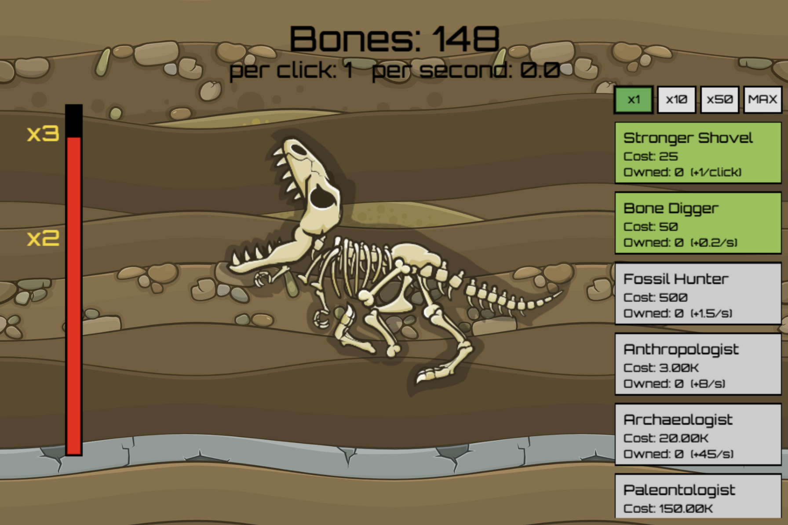

# Bone Clicker

A cookie-clicker-style game where you dig up bones by clicking a T-Rex. Built with HTML, CSS, and JavaScript using the canvas.

## How to Play
- Click the T-Rex to earn bones.
- Buy upgrades in the shop on the right to earn more per click or earn bones automatically every second.
- Build up the boost meter on the left by clicking quickly. Reaching the x2 and x3 lines multiplies the bones you get per click. Stop clicking and the meter slowly drains.
## Features
- Click upgrades (Stronger Shovel) and passive upgrades (Bone Digger through Jurassic Park)
- Upgrade prices rise with every copy you own
- Buy in bulk with the x1 / x10 / x50 / MAX buttons
- Scrollable shop
- Boost meter with x2 and x3 multipliers
- Floating "+N" text and click animation on the T-Rex
## Run It

No install needed. Download or clone the project and open index.html in your browser, or play it below.

**[Play it here](https://salcampanella.github.io/Bone_Clicker/)**
